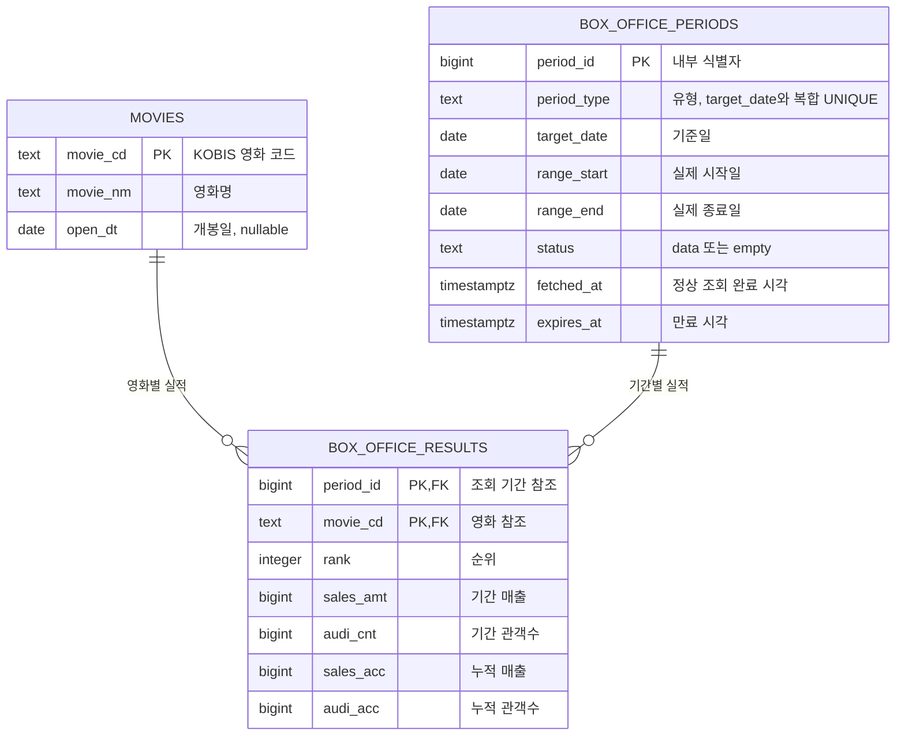

# 박스오피스 데이터 테이블 설계

작성일: 2026-10-24  
기준 문서: [ARCHITECTURE.md](./ARCHITECTURE.md), [PRD.md](./PRD.md)

## 1. 저장할 데이터

| 데이터 묶음 | 저장 항목 | KOBIS 필드 또는 출처 |
| --- | --- | --- |
| 영화 정보 | 영화 코드, 영화명, 개봉일 | `movieCd`, `movieNm`, `openDt` |
| 조회 기간 | 기간 유형(일간·주간·주말), 기준일, 실제 시작일·종료일 | 요청 조건, 응답 `showRange` |
| 기간별 영화 실적 | 순위, 기간 매출, 기간 관객수, 누적 매출, 누적 관객수 | `rank`, `salesAmt`, `audiCnt`, `salesAcc`, `audiAcc` |
| 조회 상태·캐시 메타데이터 | 정상 데이터/정상 빈 응답, 조회 완료 시각, 만료 시각 | 서버에서 생성 |

매출은 원, 관객수는 명 단위다. 누적 수치는 해당 응답 시점의 스냅샷이므로 영화 테이블의 고정 속성이 아니라 기간별 실적에 저장한다.

KOBIS는 숫자도 문자열로 반환한다. 서버에서 검증한 뒤 순위는 정수, 매출·관객수는 정밀도를 보존하는 정수로 변환한다. 영화 코드는 숫자처럼 보여도 식별자이므로 문자열로 유지한다. 개봉일이 없으면 `NULL`로 저장한다.

### 기존 캐시 설계와의 관계

ARCHITECTURE.md는 단일 `box_office_cache.payload` JSONB 스냅샷을 제안했다. **이 문서는 요청에 따라 그 저장 방식을 영화/조회 기간/기간별 실적의 세 테이블로 정규화하는 대체 설계**다. 조회 상태와 TTL은 조회 기간 테이블이 맡으며, 동일 데이터를 JSONB와 실적 테이블에 이중 저장하지 않는다. 적용 시 ARCHITECTURE.md의 DB 캐시 절과 저장 코드를 이 모델로 맞춘다.

조회 범위는 기존 설계처럼 목록 크기 10·전체 영화 조건으로 고정한다. 향후 지역·국적·목록 크기 등의 필터를 추가하면 조회 기간의 유일성 키에도 해당 조건을 추가해야 한다. 외부 호출의 동시 갱신 조정 정보는 이 세 도메인 테이블과 별개인 운영 관심사다.

## 2. 하나의 표에 모두 저장하면 생기는 문제

가령 다음과 같은 표를 만들면 영화 정보와 조회 기간 정보가 영화별·날짜별 행마다 반복된다.

```text
박스오피스_전체(
  기간유형, 기준일, 실제시작일, 실제종료일, 조회상태, 조회시각, 만료시각,
  영화코드, 영화명, 개봉일,
  순위, 기간매출, 기간관객수, 누적매출, 누적관객수
)
후보 기본키: (기간유형, 기준일, 영화코드)
```

| 이상 현상 | 구체적인 문제 | 분리 후 해결 |
| --- | --- | --- |
| 삽입 이상 | 실적이 없는 영화의 기본 정보만 등록하기 어렵다. 정상 빈 응답도 영화 코드 없이 기간 상태만 저장할 수 없어 가짜 영화 행이나 NULL 키가 필요해진다. | 영화 정보는 `movies`, 빈 조회 결과는 실적 없이 `box_office_periods`에 저장한다. |
| 수정 이상 | 영화명·개봉일을 고칠 때 모든 날짜 행을 수정해야 한다. 같은 기간의 만료 시각도 영화 수만큼 반복되어 일부 행만 바뀌면 서로 충돌한다. | 영화 속성은 영화 행 한 곳에서, 기간 메타데이터는 기간 행 한 곳에서 수정한다. |
| 삭제 이상 | 영화의 마지막 실적 행을 삭제하면 영화명·개봉일도 사라진다. 기간의 마지막 영화 행을 삭제하면 해당 기간을 정상 조회했다는 기록도 사라진다. | 실적을 삭제해도 영화와 조회 기간은 독립적으로 유지한다. |

함수 종속은 `영화코드 → 영화명·개봉일`, `(기간유형, 기준일) → 실제기간·조회상태·조회시각·만료시각`, `(조회기간, 영화코드) → 실적`으로 나뉜다. 각 속성을 그 속성을 결정하는 키의 테이블로 옮겨 위 중복과 이상을 제거한다.

## 3. 세 테이블과 키

### 3.1 movies — 영화

| 컬럼 | PostgreSQL 타입 | 키·필수 여부 | 설명 |
| --- | --- | --- | --- |
| `movie_cd` | `text` | **PK**, NOT NULL | KOBIS 영화 코드 |
| `movie_nm` | `text` | NOT NULL | 영화명 |
| `open_dt` | `date` | NULL 허용 | 개봉일 |

영화명은 중복될 수 있으므로 유일성 키로 사용하지 않는다. 영화명·개봉일은 최신 검증값을 유지한다. 과거 응답에 실렸던 제목 자체를 보존하는 이력 관리는 이 설계의 범위 밖이다. 누락된 개봉일 응답으로 기존의 유효한 개봉일을 지우지 않는다.

### 3.2 box_office_periods — 조회 기간

| 컬럼 | PostgreSQL 타입 | 키·필수 여부 | 설명 |
| --- | --- | --- | --- |
| `period_id` | `bigint` identity | **PK**, NOT NULL | 내부 조회 기간 식별자 |
| `period_type` | `text` | NOT NULL | `daily`, `weekly`, `weekend` 중 하나 |
| `target_date` | `date` | NOT NULL | API에 전달한 기준일 |
| `range_start` | `date` | NOT NULL | 응답의 실제 조회 시작일 |
| `range_end` | `date` | NOT NULL | 응답의 실제 조회 종료일 |
| `status` | `text` | NOT NULL | 정상 응답의 `data` 또는 `empty` |
| `fetched_at` | `timestamptz` | NOT NULL | 마지막 정상 외부 조회 완료 시각 |
| `expires_at` | `timestamptz` | NOT NULL | 캐시 만료 시각 |

- **UNIQUE (`period_type`, `target_date`)**: 같은 요청 조건을 중복 저장하지 않는다. 날짜만 키로 잡으면 일간·주간·주말이 충돌한다.
- `range_start <= range_end`, `expires_at > fetched_at`을 검사한다. 일간은 시작일·종료일이 기준일과 같아야 한다.
- 주간·주말은 응답 실제 기간을 저장한다. 서로 다른 기준일이 같은 실제 기간을 가리킬 수 있으므로 `range_start`, `range_end`에는 별도 UNIQUE를 걸지 않는다.
- 성공한 조회만 저장한다. 행이 없으면 ‘저장된 정상 조회 없음’, `empty` 행이 있으면 ‘정상 조회했으나 결과 없음’이다. 외부 오류는 `empty`로 기록하지 않는다.
- B단계의 데이터 TTL은 24시간, 정상 빈 응답 TTL은 1시간이다. 조회만으로 만료 시각을 연장하지 않는다.

### 3.3 box_office_results — 기간별 영화 실적

| 컬럼 | PostgreSQL 타입 | 키·필수 여부 | 설명 |
| --- | --- | --- | --- |
| `period_id` | `bigint` | **PK 일부, FK**, NOT NULL | `box_office_periods.period_id` 참조 |
| `movie_cd` | `text` | **PK 일부, FK**, NOT NULL | `movies.movie_cd` 참조 |
| `rank` | `integer` | NOT NULL | 해당 기간 순위, 양의 정수 |
| `sales_amt` | `bigint` | NOT NULL | 기간 매출(원) |
| `audi_cnt` | `bigint` | NOT NULL | 기간 관객수(명) |
| `sales_acc` | `bigint` | NOT NULL | 응답 시점 누적 매출(원) |
| `audi_acc` | `bigint` | NOT NULL | 응답 시점 누적 관객수(명) |

- **복합 PK (`period_id`, `movie_cd`)**: 한 조회 기간에서 같은 영화는 한 번만 저장한다.
- 기간 FK는 `ON DELETE CASCADE`: 기간을 명시적으로 삭제하면 해당 실적도 삭제한다.
- 영화 FK는 `ON DELETE RESTRICT`: 실적이 참조 중인 영화를 실수로 삭제하지 못하게 한다.
- 순위는 식별자가 아니다. 동순위 가능성을 임의로 배제하지 않도록 `(period_id, rank)`에 UNIQUE를 걸지 않는다.
- PostgreSQL `bigint` 범위를 넘는 값은 저장 전에 오류로 처리한다. 부호 허용 여부는 외부 계약 확인 후 확정하며, 확인 전에 금액·관객수에 일괄 비음수 제약을 두지 않는다.
- 목록용 `(period_id, rank)` 인덱스와 영화별 이력용 `(movie_cd, period_id)` 인덱스를 둔다.

### 저장·갱신의 일관성

외부 요청과 검증을 먼저 완료한 뒤, **한 DB 트랜잭션**으로 영화 upsert → 기간 upsert 및 잠금 → 해당 기간의 기존 실적 전체 교체 → 상태·시각 갱신을 수행한다. 원자적 서버 DB 함수 등으로 묶고 여러 독립 HTTP 쓰기로 나누지 않는다.

- `status=data`이면 실적이 1개 이상, `status=empty`이면 실적이 0개여야 한다. 이는 테이블 간 조건이므로 단순 행 CHECK 대신 저장 트랜잭션과 필요 시 지연 제약 트리거로 보장한다.
- 갱신 결과에서 빠진 영화의 이전 실적도 제거해야 한다. 추가/upsert만 하면 오래된 영화가 남는다.
- 정상 빈 응답으로 바뀌면 기간 행은 유지하고 실적을 모두 제거한다.
- 외부 실패나 저장 실패 시 롤백하여 이전 정상 기간·실적·TTL을 보존한다. 동시 갱신은 기존 아키텍처의 임대 소유권 검증을 거친다.
- 큰 정수는 서버에서 정수로 연산하고 API JSON에는 십진 문자열로 직렬화한다. DB 드라이버 경계에서도 부정확한 JavaScript `number`로 변환하지 않는다.

## 4. ERD



영화 한 편은 실적이 0개 이상이며, 조회 기간 하나도 정상 빈 응답을 포함하므로 실적이 0개 이상이다. 각 실적은 반드시 영화 한 편과 조회 기간 하나를 참조한다. 영화와 조회 기간의 다대다 관계를 실적 테이블이 연결한다.

## 5. 가상 데이터: 영화 2개 × 일간 조회 3일

아래 영화 코드·제목·실적은 모두 설명용 가상 값이다. 금액은 원, 관객수는 명이다.

### movies — 2행

| movie_cd | movie_nm | open_dt |
| --- | --- | --- |
| F001 | 별빛 극장 | 2026-10-21 |
| F002 | 바다의 편지 | 2026-10-21 |

### box_office_periods — 3행

| period_id | period_type | target_date | range_start | range_end | status | fetched_at | expires_at |
| --- | --- | --- | --- | --- | --- | --- | --- |
| 101 | daily | 2026-10-21 | 2026-10-21 | 2026-10-21 | data | 2026-10-24 09:00+09 | 2026-10-24 10:00+09 |
| 102 | daily | 2026-10-22 | 2026-10-22 | 2026-10-22 | data | 2026-10-24 09:00+09 | 2026-10-24 10:00+09 |
| 103 | daily | 2026-10-23 | 2026-10-23 | 2026-10-23 | data | 2026-10-24 09:00+09 | 2026-10-24 10:00+09 |

### box_office_results — 6행

| period_id | movie_cd | rank | sales_amt | audi_cnt | sales_acc | audi_acc |
| --- | --- | --- | --- | --- | --- | --- |
| 101 | F001 | 1 | 100000000 | 10000 | 100000000 | 10000 |
| 101 | F002 | 2 | 80000000 | 8000 | 80000000 | 8000 |
| 102 | F001 | 2 | 120000000 | 12000 | 220000000 | 22000 |
| 102 | F002 | 1 | 150000000 | 15000 | 230000000 | 23000 |
| 103 | F001 | 1 | 200000000 | 20000 | 420000000 | 42000 |
| 103 | F002 | 2 | 160000000 | 16000 | 390000000 | 39000 |

### 5.1 날짜별 목록: 세 테이블 JOIN

다음은 `2026-10-23` 일간 목록을 조회하는 PostgreSQL 예시다. 실제 API에서는 날짜와 유형을 바인딩 파라미터로 전달한다. 서비스는 먼저 기간의 존재·만료·상태를 확인하고 필요한 외부 갱신을 마친 뒤 목록을 읽는다.

```sql
SELECT
    p.period_type,
    p.target_date,
    p.range_start,
    p.range_end,
    r.rank,
    m.movie_cd,
    m.movie_nm,
    m.open_dt,
    r.sales_amt,
    r.audi_cnt,
    r.sales_acc,
    r.audi_acc
FROM box_office_periods AS p
JOIN box_office_results AS r ON r.period_id = p.period_id
JOIN movies AS m ON m.movie_cd = r.movie_cd
WHERE p.period_type = 'daily'
  AND p.target_date = DATE '2026-10-23'
  AND p.status = 'data'
ORDER BY r.rank, m.movie_cd;
```

위 SQL은 JOIN을 설명하기 위한 저장 데이터 조회다. 운영에서 만료 데이터를 바로 제공하는 쿼리가 아니며, 유효성 확인과 조회는 동일 스냅샷에서 수행하거나 최종 쿼리에 `p.expires_at > CURRENT_TIMESTAMP` 조건을 함께 적용한다.

화면 출력 예시:

| 순위 | 영화명 | 개봉일 | 매출(원) | 관객수(명) | 누적 관객수(명) |
| --- | --- | --- | --- | --- | --- |
| 1 | 별빛 극장 | 2026-10-21 | 200,000,000 | 20,000 | 42,000 |
| 2 | 바다의 편지 | 2026-10-21 | 160,000,000 | 16,000 | 39,000 |

`movie_cd`는 식별·링크·집계에 사용하고 `sales_acc`는 데이터로 보존한다. F1 기본 출력 열은 PRD의 여섯 항목을 따른다.

### 5.2 3일 인사이트: 영화별 합산 JOIN

이 예시는 설명을 위해 3일을 사용한다. 실제 F2의 선택지는 PRD대로 7/14/30일이다. 서비스는 요청한 모든 날짜가 정상 조회됐고 만료되지 않았는지 먼저 확인한다. 아래 합산 SQL만 실행해서 누락·오류 날짜를 조용히 제외해서는 안 된다.

```sql
SELECT
    m.movie_cd,
    m.movie_nm,
    SUM(r.sales_amt) AS period_sales,
    SUM(r.audi_cnt) AS period_audience
FROM box_office_periods AS p
JOIN box_office_results AS r ON r.period_id = p.period_id
JOIN movies AS m ON m.movie_cd = r.movie_cd
WHERE p.period_type = 'daily'
  AND p.target_date BETWEEN DATE '2026-10-21' AND DATE '2026-10-23'
  AND p.status = 'data'
GROUP BY m.movie_cd, m.movie_nm
ORDER BY period_sales DESC, period_audience DESC, m.movie_cd
LIMIT 5;
```

| 순서 | 영화명 | 3일 매출 합계(원) | 3일 관객수 합계(명) |
| --- | --- | --- | --- |
| 1 | 별빛 극장 | 420,000,000 | 42,000 |
| 2 | 바다의 편지 | 390,000,000 | 39,000 |

기간 총매출은 810,000,000원, 총관객수는 81,000명이다. 누적 매출·누적 관객수는 SUM하지 않는다. 예시에서는 개봉일부터 3일만 존재해 기간 합계와 마지막 누적값이 같지만, 일반적으로는 같지 않다.

### 5.3 정상 빈 응답과 미조회 구분

영화 목록에는 INNER JOIN을 사용해도 되지만, 날짜별 조회 상태를 파악할 때는 기간을 기준으로 LEFT JOIN한다. 예를 들어 `period_id=103`이 `status=empty`이고 실적이 0행이라면 아래 쿼리는 해당 날짜를 그대로 남긴다.

```sql
SELECT
    p.target_date,
    p.status,
    COUNT(r.movie_cd) AS movie_count,
    SUM(r.sales_amt) AS daily_sales,
    SUM(r.audi_cnt) AS daily_audience
FROM box_office_periods AS p
LEFT JOIN box_office_results AS r ON r.period_id = p.period_id
WHERE p.period_type = 'daily'
  AND p.target_date BETWEEN DATE '2026-10-21' AND DATE '2026-10-23'
GROUP BY p.period_id, p.target_date, p.status
ORDER BY p.target_date;
```

빈 날짜의 합계 `NULL`을 `COALESCE(..., 0)`로 바꾸지 않는다. 화면에서는 ‘데이터 없음’과 차트 공백으로 표시한다. 기간 행 자체가 없으면 위 쿼리에도 날짜가 나오지 않으므로, 서버가 생성한 요청 날짜 목록과 비교해 미조회 날짜를 찾고 조회를 수행한다. 한 날짜라도 갱신에 실패하면 기간 Top·총합의 확정 표시를 중단한다.
